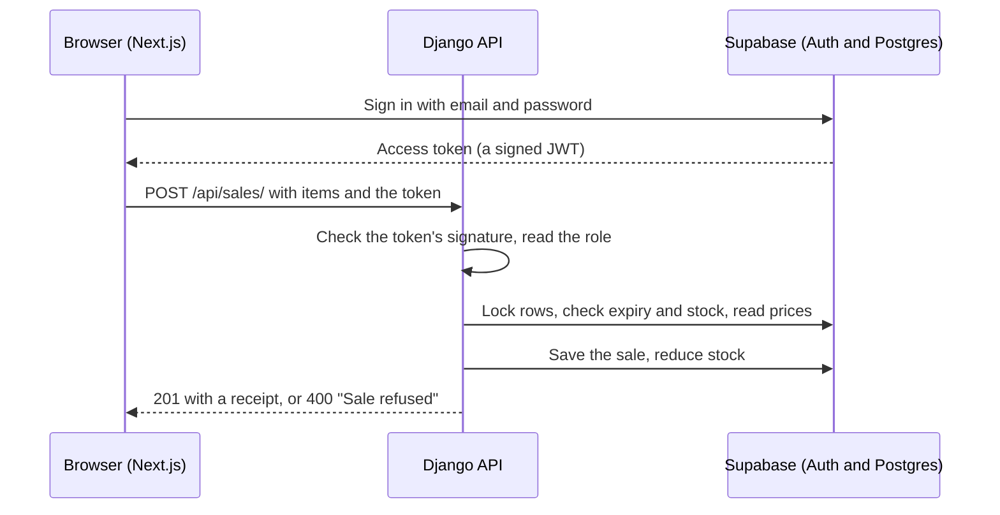

# Pharmacy Desk

A stock and sales system for a pharmacy counter. Pharmacists sell medicine; managers manage stock and read the sales report. The server refuses to sell expired or out-of-stock medicine, even when the screen is out of date.

## Live demo

| Part | Link |
|---|---|
| Frontend (Next.js on Vercel) | https://pharmacy-system-teal-alpha.vercel.app |
| API (Django on Render) | https://pharmacy-api-2v30.onrender.com/api/ |

**Note:** the API runs on a free plan and sleeps when idle. The first request
after a pause can take up to 50 seconds. Open the API link once and wait
before testing.

### Try the API with curl

Every endpoint needs a Supabase access token. Without one you get 401:

    curl https://pharmacy-api-2v30.onrender.com/api/medicines/

To get a token, run `python backend/get_token.py` locally (it asks for an
email and password), then:

    curl -H "Authorization: Bearer YOUR_TOKEN" https://pharmacy-api-2v30.onrender.com/api/medicines/

### Run the tests

```
cd backend
venv\Scripts\activate
python manage.py test --settings=config.test_settings
```

The tests use a temporary in-memory database, so your Supabase data is never touched.

### Deployment

- Frontend: Vercel, root directory `frontend`.
  Variables: `NEXT_PUBLIC_API_URL`, `NEXT_PUBLIC_SUPABASE_URL`,
  `NEXT_PUBLIC_SUPABASE_PUBLISHABLE_KEY`.
- API: Render, root directory `backend`.
  Build: `pip install -r requirements.txt && python manage.py collectstatic --noinput`.
  Start: `gunicorn config.wsgi`.
  Variables: `SECRET_KEY`, `DEBUG`, `ALLOWED_HOSTS`, `FRONTEND_URL`,
  `DB_HOST`, `DB_PORT`, `DB_NAME`, `DB_USER`, `DB_PASSWORD`, `SUPABASE_URL`,
  `SUPABASE_SERVICE_ROLE_KEY` (server-side only; never expose it to the frontend).
- Database and login: Supabase.

## Stack

| Layer | Technology | Job |
|---|---|---|
| Client | Next.js 16 (React, TypeScript, Tailwind CSS) | Screens only. Sends what the user chose. |
| Server | Django 6 and Django REST Framework | Rules: who is calling, what they may do, prices, stock. |
| Data and login | Supabase (PostgreSQL and Auth) | Stores the data, signs users in, issues tokens. |

## How it fits together



Three rules explain the design:

1. **The browser is not trusted.** It sends only medicine ids and quantities, never a price.
2. **Django decides.** It verifies the token with Supabase's public keys, looks up the user's role, checks expiry and stock, reads prices from the database, and saves the sale in one transaction (all or nothing).
3. **The database is locked.** Row Level Security is on with no policies, so the public Supabase key cannot read or write the tables. Only Django can.

## Roles

| Role | May do |
|---|---|
| pharmacist | Read medicines and complete sales |
| manager | Everything a pharmacist can, plus create, edit and delete medicines and read the sales report |

Managers set a shared pharmacist registration code in **Staff access**. A new pharmacist signs up with their name, email, password, and that code. The backend verifies the code before granting the pharmacist role; managers can see the authorized pharmacist roster in the same screen. The code is stored as a password hash and can be changed by a manager at any time. Changing it only affects future registrations.

## Run it locally

### 0. Requirements

Python 3.12 or newer, Node.js 20.9 or newer, Git, and a free Supabase project.

### 1. Database

1. In your Supabase project, find the **Project URL** and the **Publishable key** (Project Settings, API Keys), and the **Session pooler** connection details (the green **Connect** button).
2. For a new database, open the **SQL Editor** and run `database/schema.sql`, then `database/seed.sql`. For an existing Pharmacy Desk database, run `database/registration.sql` once instead; do not rerun the schema or seed scripts.
3. Under **Authentication, Users**, create the first manager (tick **Auto Confirm User**). Copy their UID and insert their manager profile:

   ```sql
   insert into profiles (id, role, email)
   values ('MANAGER-UID-HERE', 'manager', 'manager@example.com');
   ```

4. In Supabase Auth, copy the project's service-role key into the backend's `.env` as `SUPABASE_SERVICE_ROLE_KEY` (and into the Render backend environment in production). Keep this key private and never add it to frontend environment variables. Sign in as the manager, open **Staff access**, and set a shared code of at least 12 characters. Give it only to pharmacists you want to authorize. A valid code lets the backend create an already-confirmed account, which can sign in immediately without email confirmation. If the same email has a pending unconfirmed account from the earlier signup flow, registration confirms and activates that pending account.

### 2. Backend

```
cd backend
python -m venv venv
venv\Scripts\activate
pip install -r requirements.txt
copy .env.example .env
```

On macOS or Linux use `source venv/bin/activate` and `cp .env.example .env`.

Edit `.env` with your own values, then:

```
python manage.py check
python manage.py runserver
```

The API is now at http://127.0.0.1:8000/api/. Do not run `migrate`: the tables belong to Supabase and the models are unmanaged.

### 3. Frontend

```
cd frontend
npm install
copy .env.example .env.local
npm run dev
```

Edit `.env.local`, then open http://localhost:3000. Use `localhost`, not `127.0.0.1`: the API only allows that origin (CORS).

## Call the API with curl

This section assumes only this README and a running backend. The commands are for Windows Command Prompt. On macOS or Linux use `curl` instead of `curl.exe`, `$TOKEN` instead of `%TOKEN%`, and single quotes around the JSON.

### Step 1: get a token

```
cd backend
python get_token.py
```

Enter an email and password (ask the owner for the test password). The script prints a line starting `set TOKEN=`. Copy that line, paste it into the same window, and press Enter. The token lasts about an hour. Use the **manager** account to try everything below, and the **pharmacist** account to see what is refused.

### Step 2: make calls

`-i` makes curl print the status line.

No token, so the answer is **401**:

```
curl.exe -i http://127.0.0.1:8000/api/medicines/
```

Who am I:

```
curl.exe http://127.0.0.1:8000/api/me/ -H "Authorization: Bearer %TOKEN%"
```

List medicines, then read one:

```
curl.exe http://127.0.0.1:8000/api/medicines/ -H "Authorization: Bearer %TOKEN%"
curl.exe http://127.0.0.1:8000/api/medicines/1/ -H "Authorization: Bearer %TOKEN%"
```

Create a medicine (manager only). The reply contains its `id`; use it as `<ID>` below:

```
curl.exe -i -X POST http://127.0.0.1:8000/api/medicines/ -H "Authorization: Bearer %TOKEN%" -H "Content-Type: application/json" -d "{\"name\":\"Test medicine\",\"price\":\"500\",\"stock\":10,\"expiry_date\":\"2028-01-01\"}"
```

Bad input is refused with **400** (price must be at least 0.01):

```
curl.exe -i -X POST http://127.0.0.1:8000/api/medicines/ -H "Authorization: Bearer %TOKEN%" -H "Content-Type: application/json" -d "{\"name\":\"Bad\",\"price\":\"-5\",\"stock\":1,\"expiry_date\":\"2028-01-01\"}"
```

Change it, then delete it (manager only):

```
curl.exe -i -X PATCH http://127.0.0.1:8000/api/medicines/<ID>/ -H "Authorization: Bearer %TOKEN%" -H "Content-Type: application/json" -d "{\"stock\":50}"
curl.exe -i -X DELETE http://127.0.0.1:8000/api/medicines/<ID>/ -H "Authorization: Bearer %TOKEN%"
```

A missing record gives **404**:

```
curl.exe -i http://127.0.0.1:8000/api/medicines/999999/ -H "Authorization: Bearer %TOKEN%"
```

Sell two units of medicine 1 (this really reduces its stock):

```
curl.exe -i -X POST http://127.0.0.1:8000/api/sales/ -H "Authorization: Bearer %TOKEN%" -H "Content-Type: application/json" -d "{\"items\":[{\"medicine_id\":1,\"qty\":2}]}"
```

The reply is **201** with a receipt. The prices in it come from the database, not from the request. Now sell the expired medicine 9. The answer is **400** and nothing is saved:

```
curl.exe -i -X POST http://127.0.0.1:8000/api/sales/ -H "Authorization: Bearer %TOKEN%" -H "Content-Type: application/json" -d "{\"items\":[{\"medicine_id\":9,\"qty\":1}]}"
```

```json
{"detail":"Sale refused.","errors":[{"medicine_id":9,"name":"Old antacid","error":"expired"}]}
```

The sales report (manager only; a pharmacist's token gets **403**):

```
curl.exe "http://127.0.0.1:8000/api/analytics/?days=7&limit=5" -H "Authorization: Bearer %TOKEN%"
```

## Endpoints

| Method | Path | Who | Success | Errors |
|---|---|---|---|---|
| GET | `/api/me/` | any signed-in user | 200 | 401 |
| GET, PUT | `/api/registration/code/` | manager | 200 | 400, 401, 403 |
| POST | `/api/registration/validate/` | anyone with the code | 200 | 400, 429 |
| POST | `/api/registration/register/` | anyone with the code | 201 | 400, 409, 429, 502, 503 |
| POST | `/api/registration/activate/` | signed-in account without a role | 201 | 400, 401, 409, 429 |
| GET | `/api/staff/pharmacists/` | manager | 200 | 401, 403 |
| GET | `/api/medicines/` | pharmacist, manager | 200 | 401, 403 |
| POST | `/api/medicines/` | manager | 201 | 400, 401, 403 |
| GET | `/api/medicines/<id>/` | pharmacist, manager | 200 | 401, 403, 404 |
| PATCH, PUT | `/api/medicines/<id>/` | manager | 200 | 400, 401, 403, 404 |
| DELETE | `/api/medicines/<id>/` | manager | 204 | 401, 403, 404, 409 |
| POST | `/api/sales/` | pharmacist, manager | 201 | 400, 401, 403, 404 |
| GET | `/api/analytics/?days=7&limit=5` | manager | 200 | 400, 401, 403 |

## Status codes

| Code | Meaning here |
|---|---|
| 200, 201, 204 | Worked (read or change, created, deleted) |
| 400 | Bad input, or a sale refused by the rule below |
| 401 | The token is missing, forged or expired: Django does not know who you are |
| 403 | Django knows who you are, but your role may not do this (or you have no role) |
| 404 | No such medicine |
| 409 | A medicine that has been sold cannot be deleted, or an account already has a staff role |
| 429 | Registration-code attempts are temporarily rate-limited |

## The sale rule

A sale is refused as a whole (nothing saved, no stock changed) if any line is **expired**, **out of stock**, or asks for **more than is in stock**. A medicine id that does not exist gives 404. Each medicine may appear once per sale and the quantity must be at least 1. The sale and the stock change happen in one database transaction with row locks, so two counters selling the last unit cannot both succeed.

Medicine input is validated before it reaches the database: the name must not be empty, the price must be at least 0.01, the stock cannot be negative, and the expiry date must be a real date. The database repeats these checks as a last line of defence.

## Project structure

```
pharmacy-system/
├── README.md
├── database/
│   ├── schema.sql          Tables, constraints, Row Level Security
│   ├── registration.sql    Registration setup for an existing database
│   └── seed.sql            Sample medicines (one expired, one out of stock)
├── backend/                Django API
│   ├── config/             Settings and root URLs
│   ├── api/
│   │   ├── auth.py         Verifies Supabase tokens, loads the role
│   │   ├── permissions.py  Role rules
│   │   ├── models.py       Maps the Supabase tables (unmanaged)
│   │   ├── serializers.py  Input validation and JSON
│   │   ├── views.py        Endpoints and the sale rule
│   │   ├── throttles.py    Rate limits registration-code attempts
│   │   └── urls.py
│   ├── get_token.py        Prints a token for curl
│   ├── check_roles.py      Checks the 401 and 403 rules with real tokens
│   └── requirements.txt
└── frontend/               Next.js app
    ├── app/                Pages: dashboard, staff access, medicines, sales, sign-in/register
    ├── components/         Sidebar shell, slide-in panel
    └── lib/                API client, auth provider, helpers
```

## Known limitations

- Pharmacists can register only with the shared manager-issued code. Managers create accounts in Supabase; no public manager registration is available.
- Supabase keeps the session in the browser's local storage. A hardened deployment would use httpOnly cookies.
- The medicine list is paginated in the browser; the API returns every row.
- Sales cannot be edited or voided.
- Django runs on its development server and the app is not deployed yet.